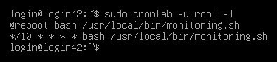
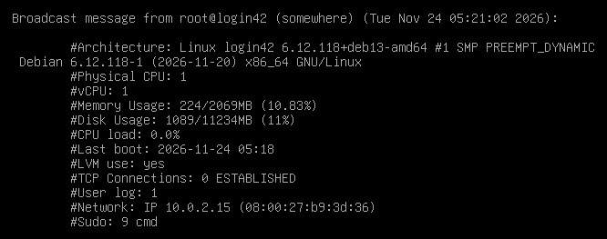

# Cron

The script must be displayed **at server startup** and then **every 10 minutes**. This is done with `cron`, the task scheduler.

## Make sure cron is there

```bash
systemctl status cron
```

It is installed and active by default on Debian 13. If it is missing:

```bash
sudo apt install cron
```

## Schedule the script

Open root's crontab:

```bash
sudo crontab -u root -e
```

Add these two lines at the end:

```
@reboot bash /usr/local/bin/monitoring.sh
*/10 * * * * bash /usr/local/bin/monitoring.sh
```


<mark style="color:green;">@reboot</mark> ➤ runs the script once at startup.

<mark style="color:green;">*/10 * * * *</mark> ➤ runs it every 10 minutes.



Run the script with `bash`, not `sh`. On Debian, `sh` is `dash`, and the subject asks for a bash script.



At startup nobody is logged in yet: the `@reboot` message is sent, but no terminal is open to receive it. The first visible display comes at the next ten-minute mark.


## Reading a crontab line

```
┌──────── minute (0-59)
│ ┌────── hour (0-23)
│ │ ┌──── day of month (1-31)
│ │ │ ┌── month (1-12)
│ │ │ │ ┌ day of week (0-7)
│ │ │ │ │
*/10 * * * * command
```

`*/10` in the minute field means "every minute divisible by 10": 0, 10, 20, 30, 40, 50.



## For the defense

The evaluator asks you to run the script **every minute**: replace `*/10` with `*/1` (or `*`) in the crontab.

They also ask you to **stop the script without modifying it**. Two ways:

```bash
sudo systemctl stop cron
```

or comment out the lines in `sudo crontab -u root -e` with a `#`.

To keep it stopped after a reboot:

```bash
sudo systemctl disable --now cron
```

To start it again:

```bash
sudo systemctl enable --now cron
```

## Check

```bash
sudo crontab -u root -l
```

Both lines must appear:

<figure><figcaption></figcaption></figure>

Wait for the next ten-minute mark: the message must show up on your terminal by itself.

<figure><figcaption></figcaption></figure>


A message sent by cron shows `(somewhere)` instead of a terminal name in its first line: cron has no terminal of its own.

