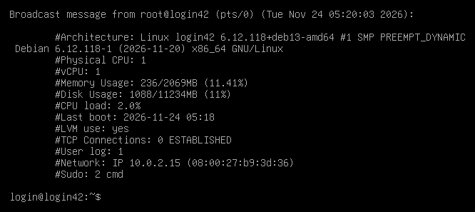

# monitoring.sh script 🚨

The subject asks for a **bash** script named `monitoring.sh`. It is displayed on every terminal at server startup, then every 10 minutes. **No error may be displayed.**

## Information to display

1. Operating system architecture and kernel version.
2. Number of physical processors.
3. Number of virtual processors.
4. RAM in use and its percentage.
5. Disk space in use and its percentage.
6. CPU load as a percentage.
7. Date and time of the last boot.
8. Whether LVM is active.
9. Number of active connections.
10. Number of logged-in users.
11. IPv4 address and MAC address.
12. Number of commands run with sudo.

## Create the script

```bash
sudo nano /usr/local/bin/monitoring.sh
```

```bash
#!/bin/bash

arch=$(uname -a)
pcpu=$(grep "physical id" /proc/cpuinfo | sort -u | wc -l)
vcpu=$(grep -c "^processor" /proc/cpuinfo)
ram=$(free --mega | awk '$1 == "Mem:" {printf "%d/%dMB (%.2f%%)", $3, $2, $3 / $2 * 100}')
disk=$(df -m -x tmpfs -x devtmpfs --total | awk '$1 == "total" {printf "%d/%dMB (%s)", $3, $2, $5}')
cpu=$(vmstat 1 2 | tail -1 | awk '{printf "%.1f%%", 100 - $15}')
boot=$(uptime -s | cut -c 1-16)
lvm=$(if lsblk | grep -q "lvm"; then echo yes; else echo no; fi)
tcp=$(ss -Ht state established | wc -l)
users=$(who | cut -d " " -f 1 | sort -u | wc -l)
ip=$(hostname -I | awk '{print $1}')
mac=$(ip link show | awk '/link\/ether/ {print $2; exit}')
sudo=$(journalctl _COMM=sudo 2>/dev/null | grep -c "COMMAND")

wall "	#Architecture: $arch
	#Physical CPU: $pcpu
	#vCPU: $vcpu
	#Memory Usage: $ram
	#Disk Usage: $disk
	#CPU load: $cpu
	#Last boot: $boot
	#LVM use: $lvm
	#TCP Connections: $tcp ESTABLISHED
	#User log: $users
	#Network: IP $ip ($mac)
	#Sudo: $sudo cmd"
```

Make it executable:

```bash
sudo chmod +x /usr/local/bin/monitoring.sh
```

## Line by line


<mark style="color:green;">arch</mark> ➤ `uname -a` prints the kernel, its version and the architecture.

<mark style="color:green;">pcpu</mark> ➤ each physical processor has its own `physical id` in `/proc/cpuinfo`. `sort -u` removes duplicates, `wc -l` counts.

<mark style="color:green;">vcpu</mark> ➤ `grep -c "^processor"` counts the `processor` lines, one per logical core.

<mark style="color:green;">ram</mark> ➤ on the `Mem:` line of `free --mega`, `$2` is the total and `$3` is the used amount. `awk` computes the percentage.

<mark style="color:green;">disk</mark> ➤ `df -m --total` adds a sum line. `-x tmpfs -x devtmpfs` leaves out in-memory filesystems.

<mark style="color:green;">cpu</mark> ➤ `vmstat 1 2` takes two samples one second apart. Column 15 of the last line is the idle percentage: `100 - idle` gives the load.

<mark style="color:green;">boot</mark> ➤ `uptime -s` gives the boot date and time. `cut` drops the seconds.

<mark style="color:green;">lvm</mark> ➤ answers `yes` if at least one device listed by `lsblk` has type `lvm`.

<mark style="color:green;">tcp</mark> ➤ `ss -Ht state established` lists established TCP connections, without a header. `wc -l` counts.

<mark style="color:green;">users</mark> ➤ `who` lists the open sessions. `cut` keeps the user name, `sort -u` removes duplicates, `wc -l` counts.

<mark style="color:green;">ip</mark> ➤ `hostname -I` prints the machine's IP addresses. `awk` keeps the first one.

<mark style="color:green;">mac</mark> ➤ keeps the address from the first `link/ether` line of `ip link show`.

<mark style="color:green;">sudo</mark> ➤ each sudo command writes a `COMMAND` line to the journal. `grep -c` counts them.


`wall` sends the message to every open terminal.


Why `vmstat 1 2` and not plain `vmstat`: the first line of `vmstat` is an average since boot. Only the second sample reflects the current load.



Why `sort -u` on the users: on Debian 13, `who` prints **two lines** for one console login (`seat0` and `tty1`). A plain `who | wc -l` would report 2 users when only one is logged in.



If `wall` displays nothing and `who` is empty, **reboot the VM**. On a minimal Debian 13 install, logins are only registered once `libpam-systemd` and `dbus` are in place. They come with `openssh-server`, and sessions opened before that are not known to the system.



On UTM (ARM Macs), `/proc/cpuinfo` has no `physical id` line: the script prints `0`. Replace the command with `lscpu | awk '/^Socket\(s\)/ {print $2}'`.


## Check

```bash
sudo bash /usr/local/bin/monitoring.sh
```

The message must show up on your terminal, with all 12 lines filled in and **no error message**. Compare the values with `free --mega`, `df -m`, `lsblk` and `hostname -I`.

<figure><figcaption></figcaption></figure>
