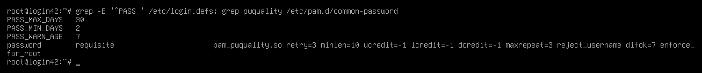
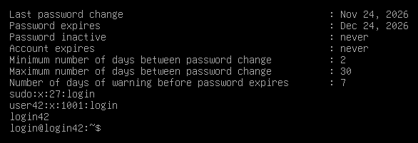
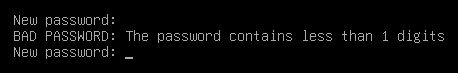

# Password policy 🔑

## What the subject asks for

| Rule | Value |
| --- | --- |
| Expiration | every 30 days |
| Minimum delay between two changes | 2 days |
| Warning before expiration | 7 days |
| Minimum length | 10 characters |
| Content | one uppercase letter, one lowercase letter, one digit |
| Identical consecutive characters | 3 at most |
| User name | forbidden in the password |
| Difference with the previous password | at least 7 characters (does not apply to root) |

The root password must follow this policy too.

## 1. Password ageing: `/etc/login.defs`

```bash
sudo nano /etc/login.defs
```

Set these three values:

```
PASS_MAX_DAYS   30
PASS_MIN_DAYS   2
PASS_WARN_AGE   7
```

> Change: `PASS_MAX_DAYS 99999` → `PASS_MAX_DAYS 30` and `PASS_MIN_DAYS 0` → `PASS_MIN_DAYS 2`. `PASS_WARN_AGE` is already `7` by default.

## 2. Apply to existing accounts: `chage`

`/etc/login.defs` only applies to accounts created **after** the change. For root and your user, which already exist:

```bash
sudo chage -M 30 -m 2 -W 7 root
sudo chage -M 30 -m 2 -W 7 login
```


This is the most common thing people forget. Without `chage`, `chage -l login` still shows `99999` days and the evaluator will see it.


## 3. Complexity: `pam_pwquality`

```bash
sudo apt install libpam-pwquality
sudo nano /etc/pam.d/common-password
```

Find the line containing `pam_pwquality.so retry=3` and complete it. This is how the line must be ↙

```
password  requisite  pam_pwquality.so retry=3 minlen=10 ucredit=-1 lcredit=-1 dcredit=-1 maxrepeat=3 reject_username difok=7 enforce_for_root
```


<mark style="color:green;">minlen=10</mark> ➤ at least 10 characters.

<mark style="color:green;">ucredit=-1</mark> ➤ at least one uppercase letter.

<mark style="color:green;">lcredit=-1</mark> ➤ at least one lowercase letter.

<mark style="color:green;">dcredit=-1</mark> ➤ at least one digit.

<mark style="color:green;">maxrepeat=3</mark> ➤ no more than 3 identical characters in a row.

<mark style="color:green;">reject_username</mark> ➤ rejects the user name inside the password.

<mark style="color:green;">difok=7</mark> ➤ 7 characters that differ from the previous password.

<mark style="color:green;">enforce_for_root</mark> ➤ applies these rules to root as well.


This is how both files must look ↙

<figure><figcaption></figcaption></figure>

**Why `difok` does not apply to root**: when root changes a password, the old one is not asked. The module has nothing to compare against, so the 7-character rule is skipped. That is exactly the exception described in the subject.

## 4. Change every password

The subject requires it once the configuration is done:

```bash
sudo passwd login
sudo passwd root
```

## Check

```bash
sudo chage -l login
sudo chage -l root
```

The minimum, maximum and warning lines must show `2`, `30` and `7`.

<figure><figcaption></figcaption></figure>

Also try a weak password such as `abc`. It must be rejected:

<figure><figcaption></figcaption></figure>
