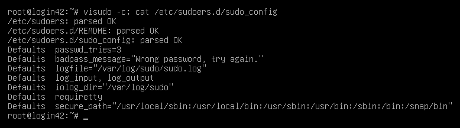
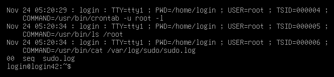

# Sudo rules

## What the subject asks for

- At most 3 attempts when the password is wrong.
- A custom message when the password is wrong.
- Every action logged, inputs and outputs included, in `/var/log/sudo/`.
- TTY mode enabled.
- The paths usable by sudo restricted.

## Create the log folder

```bash
sudo mkdir -p /var/log/sudo
```

## Write the configuration

Do not edit `/etc/sudoers` directly. Create a file in `/etc/sudoers.d/` with `visudo`, which checks the syntax before saving:

```bash
sudo visudo -f /etc/sudoers.d/sudo_config
```


The file name must contain **no dot** and must not end with `~`, otherwise sudo silently ignores it. `sudo_config` works, `sudo.conf` does not.


Content:

```
Defaults  passwd_tries=3
Defaults  badpass_message="Wrong password, try again."
Defaults  logfile="/var/log/sudo/sudo.log"
Defaults  log_input, log_output
Defaults  iolog_dir="/var/log/sudo"
Defaults  requiretty
Defaults  secure_path="/usr/local/sbin:/usr/local/bin:/usr/sbin:/usr/bin:/sbin:/bin:/snap/bin"
```

## What each line does


<mark style="color:green;">passwd_tries=3</mark>: 3 password attempts.



<mark style="color:green;">badpass_message</mark>: message shown after a wrong password.



<mark style="color:green;">logfile</mark>: file where every sudo command is recorded.



<mark style="color:green;">log_input, log_output</mark>: records what is typed and what is displayed.



<mark style="color:green;">iolog_dir</mark>: folder holding the input and output recordings.



<mark style="color:green;">requiretty</mark>: sudo only works from a real terminal. A script started without a terminal (by cron or through a web exploit, for example) cannot use sudo.



<mark style="color:green;">secure_path</mark>: `PATH` used by commands run through sudo. sudo ignores the user's `PATH`, so a fake program dropped in a personal folder cannot run in place of a real command.


## Check

As root, check the syntax and the content:

```bash
visudo -c
cat /etc/sudoers.d/sudo_config
```

<figure><figcaption></figcaption></figure>

Then, with your user:

```bash
sudo ls /root
sudo cat /var/log/sudo/sudo.log
sudo ls /var/log/sudo
```

`sudo.log` must contain the commands you just ran. The folder must also contain recording subfolders (for example `00`).

<figure><figcaption></figcaption></figure>

To test the custom message, open a new session and type a wrong password after `sudo ls`.
