# Installing Debian 13

Start the VM. In the installer menu, choose **Install** (text mode), not **Graphical install**.

<figure>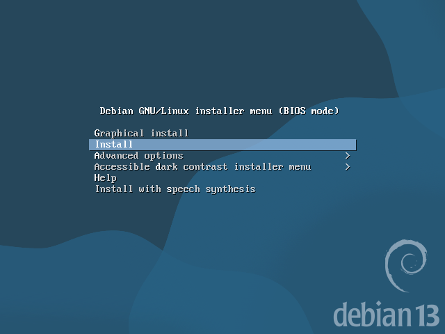<figcaption></figcaption></figure>


The subject forbids any graphical server (X.org, Wayland or equivalent). Installing one means a grade of 0.


## Language, location, keyboard

1. **Language**: <mark style="color:green;">English</mark> (error messages are easier to search for).

<figure>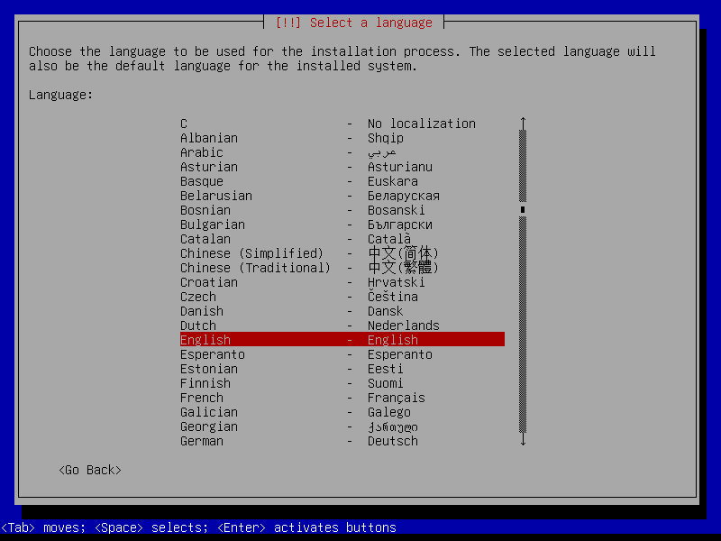<figcaption></figcaption></figure>

2. **Location**: your country. If it is not in the short list, choose `other`.

<figure>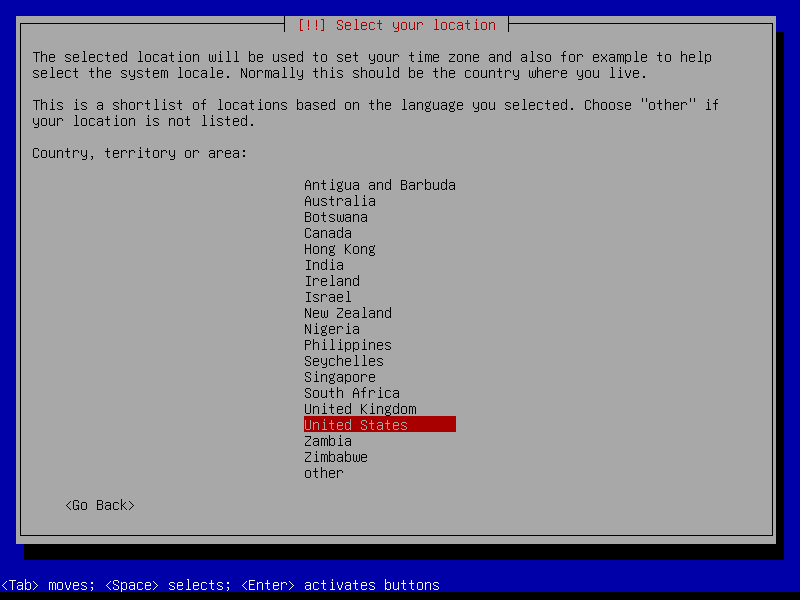<figcaption></figcaption></figure>

3. **Keymap**: the layout of your physical keyboard.

<figure>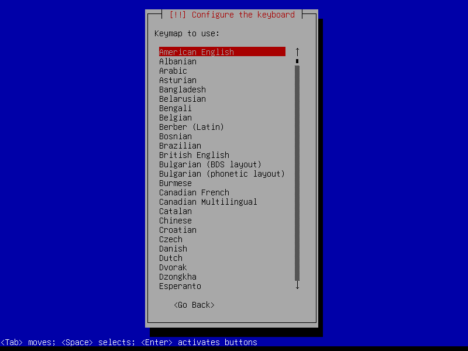<figcaption></figcaption></figure>

## Network

1. **Hostname**: your login followed by `42`, for example `wil42`. This is a subject requirement.

<figure>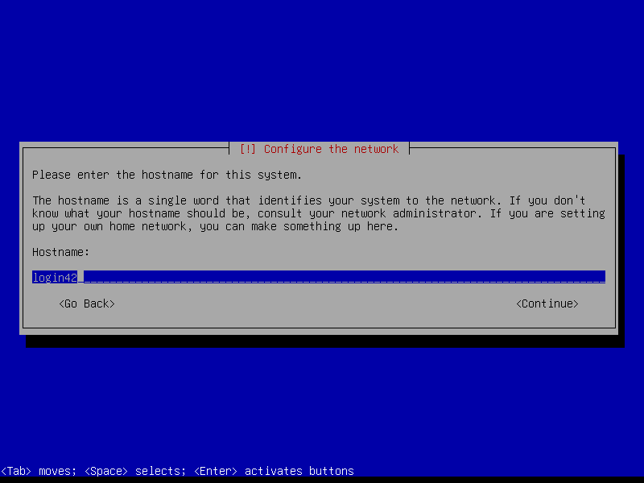<figcaption></figcaption></figure>

2. **Domain name**: leave it empty.

<figure>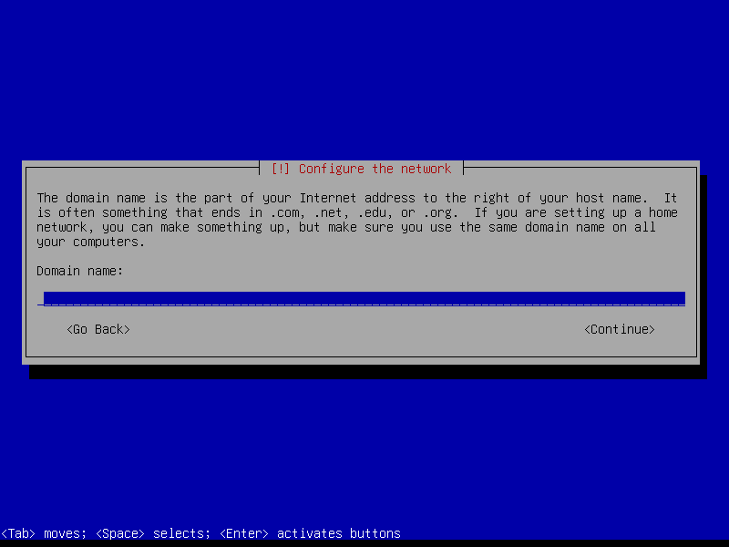<figcaption></figcaption></figure>

## Users

1. **Root password**: pick one that already follows the subject's policy (at least 10 characters, one uppercase letter, one lowercase letter, one digit, no more than 3 identical characters in a row). The installer asks for it twice.

<figure>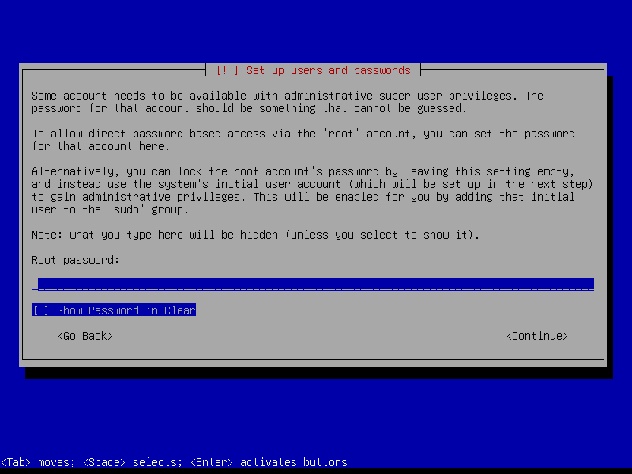<figcaption></figcaption></figure>


Setting a root password here means `sudo` is **not** installed. That is intended: the subject asks you to install and configure it yourself.


2. **Full name**: your login.

<figure>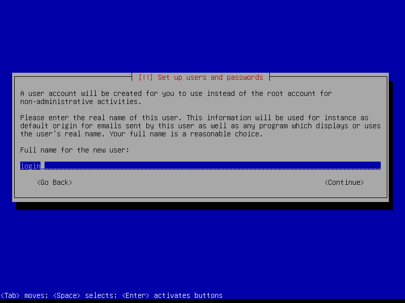<figcaption></figcaption></figure>

3. **Username**: your login.

<figure>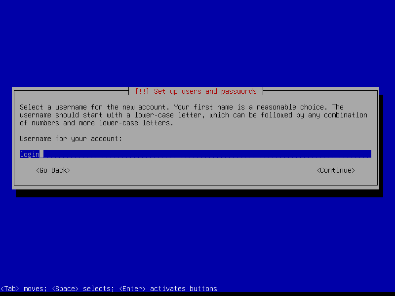<figcaption></figcaption></figure>

4. **Password**: same rule as for root, asked twice.

<figure>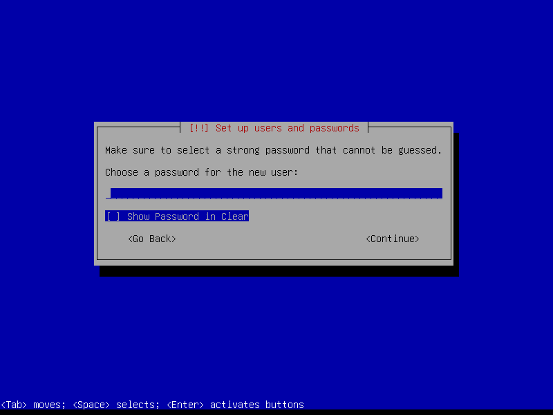<figcaption></figcaption></figure>

## Clock

Select your time zone.

<figure>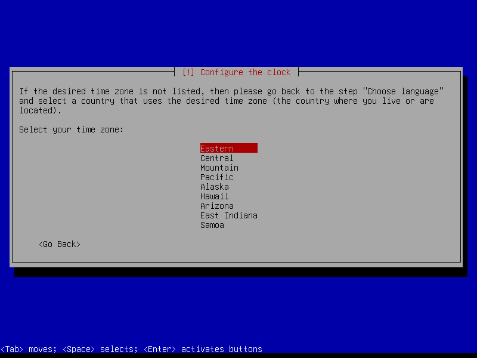<figcaption></figcaption></figure>

## Partitioning

This step has its own page: [Encrypted partitions and LVM](partitions.md). Do it, then come back here.

## Package manager

1. **Scan extra installation media**: <mark style="color:green;">No</mark>.

<figure>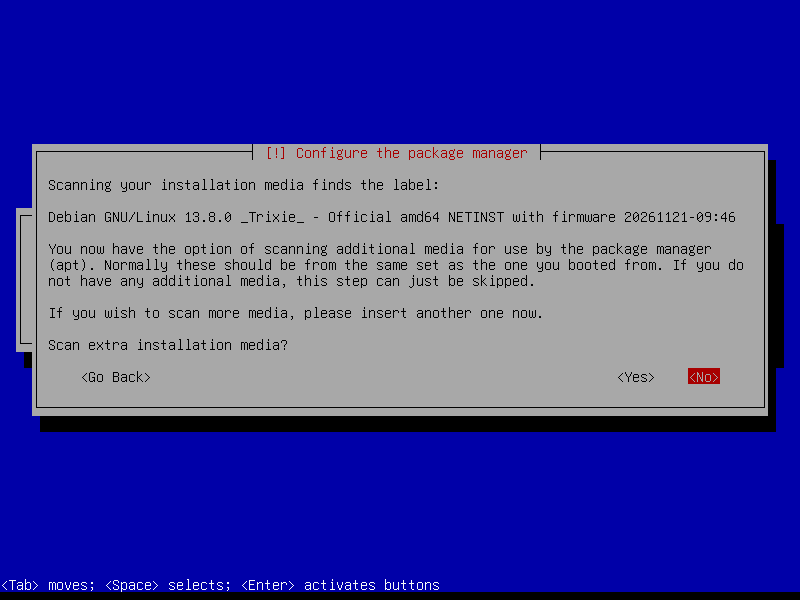<figcaption></figcaption></figure>

2. **Mirror country**: your country.

<figure>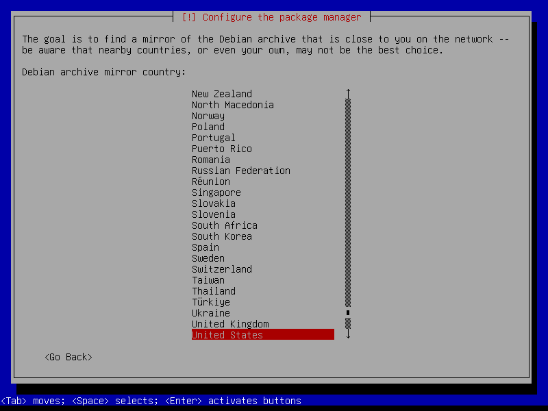<figcaption></figcaption></figure>

3. **Mirror**: <mark style="color:green;">deb.debian.org</mark>.

<figure>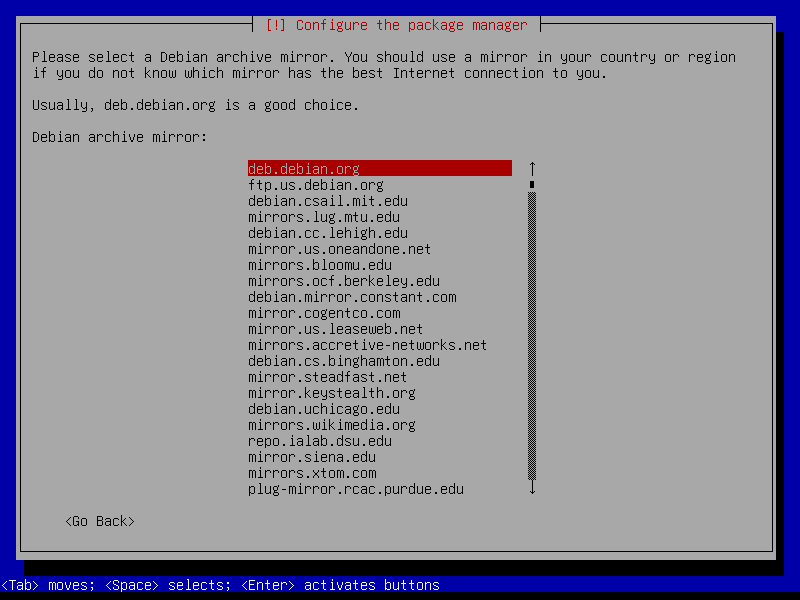<figcaption></figcaption></figure>

4. **HTTP proxy**: leave it empty.

<figure>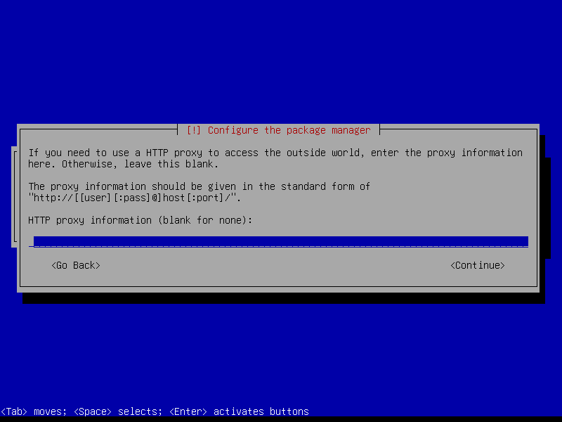<figcaption></figcaption></figure>

5. **Popularity contest**: <mark style="color:green;">No</mark>.

<figure>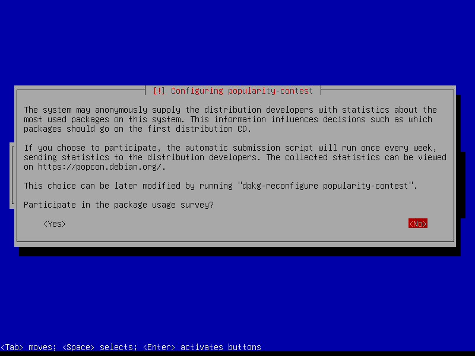<figcaption></figcaption></figure>

## Software selection

Untick **everything** with the space bar, including `Debian desktop environment`, `GNOME` and `standard system utilities`, then **Continue**.

<figure>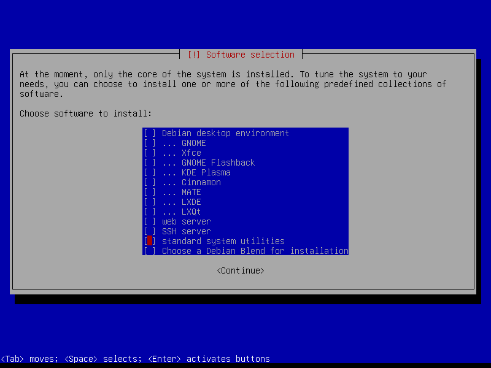<figcaption></figcaption></figure>

SSH is installed by hand later so that you understand what you are doing.

## GRUB

1. **Install the GRUB boot loader to your primary drive**: <mark style="color:green;">Yes</mark>.

<figure>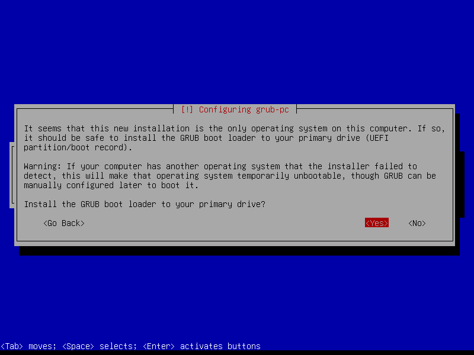<figcaption></figcaption></figure>

2. Device: <mark style="color:green;">/dev/sda</mark>.

<figure>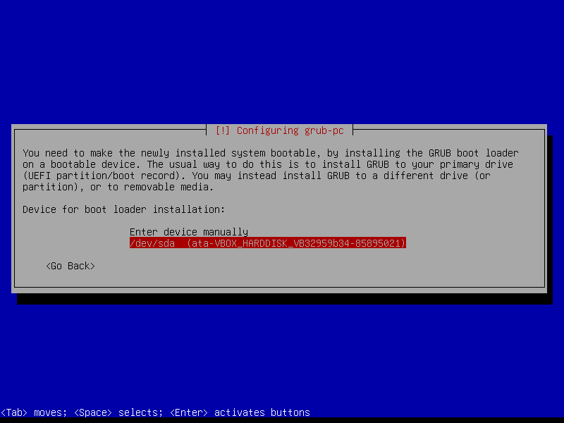<figcaption></figcaption></figure>

3. **Continue** to reboot.

<figure>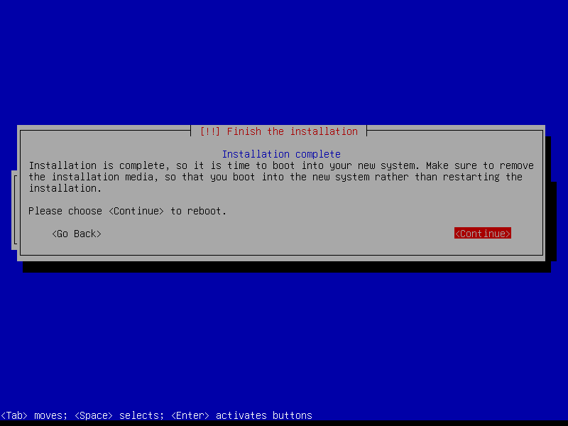<figcaption></figcaption></figure>

## Check

After the reboot:

1. The VM asks for the disk **encryption passphrase**.

<figure>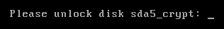<figcaption></figcaption></figure>

2. It then shows a text login prompt, with no graphical interface. Log in with your login.

<figure>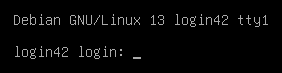<figcaption></figcaption></figure>
