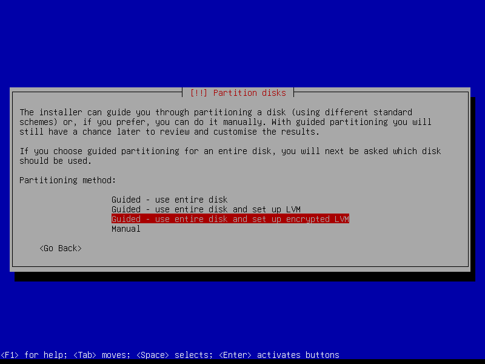
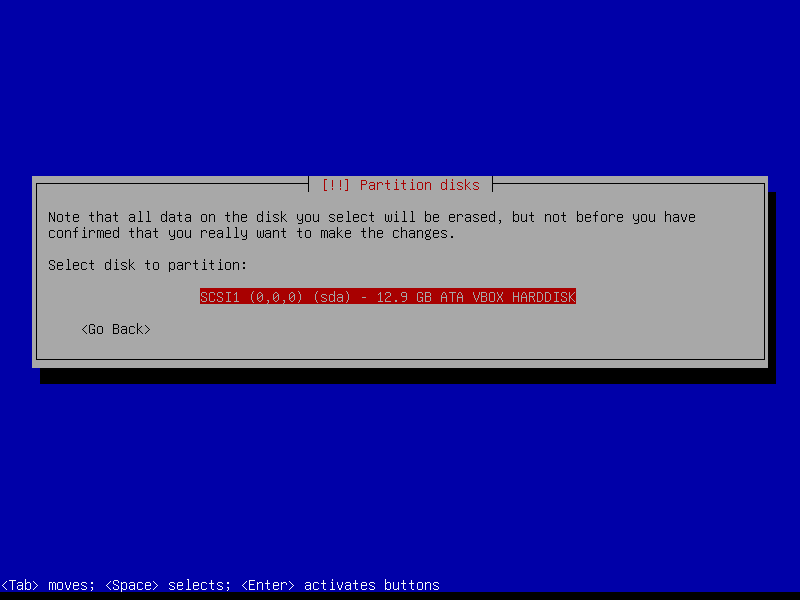
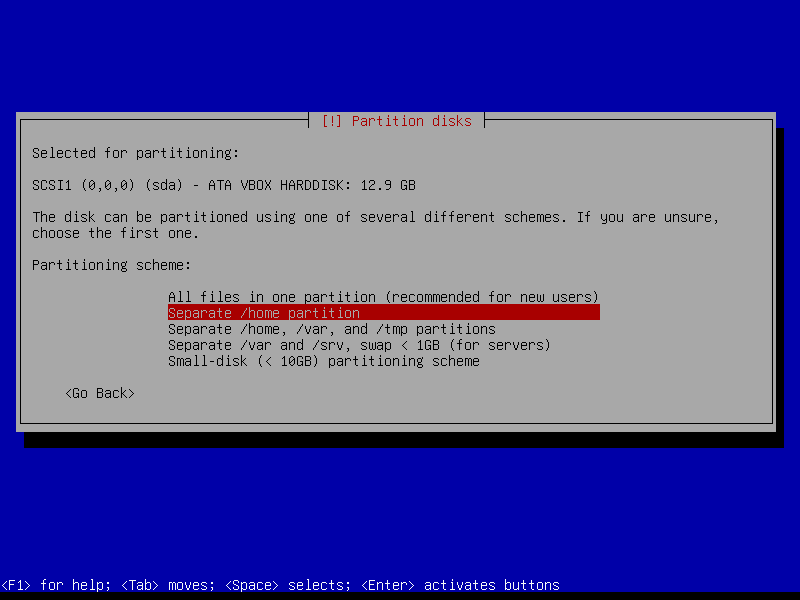
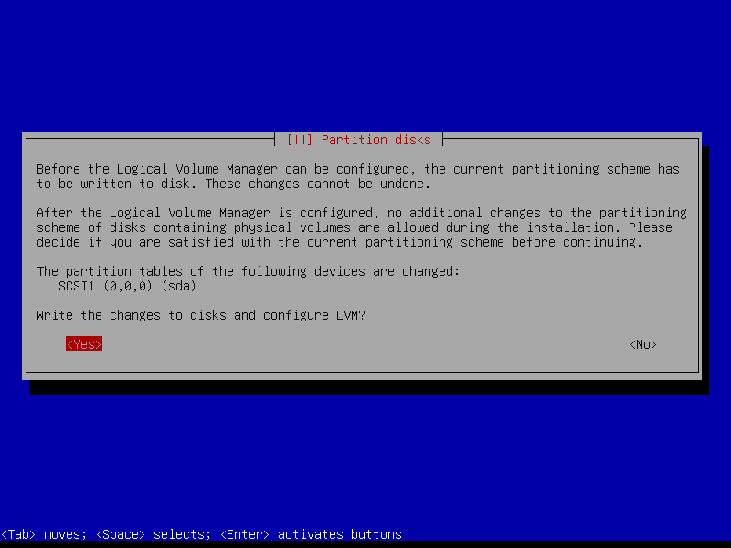
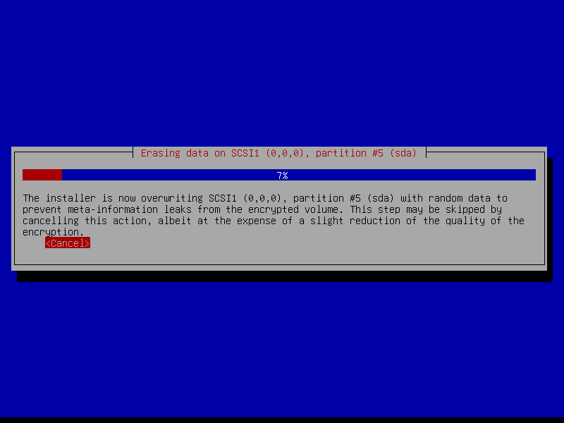
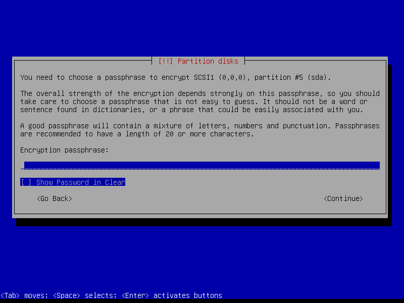
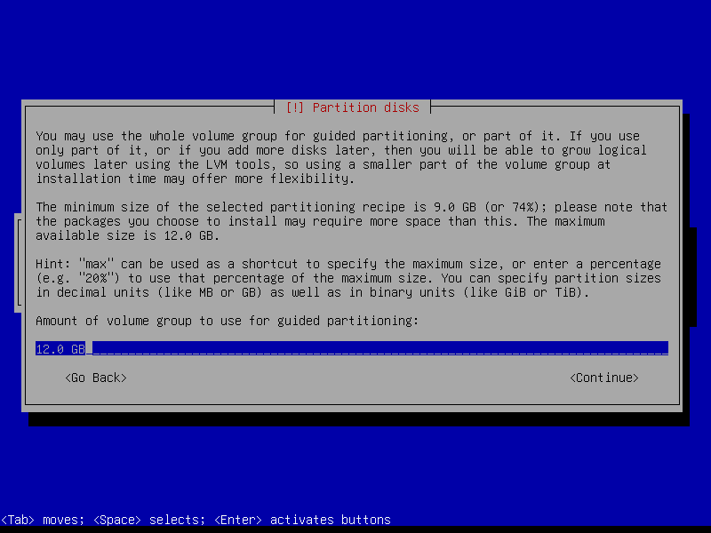
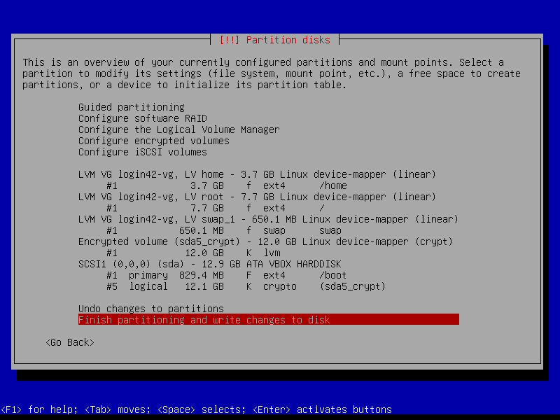
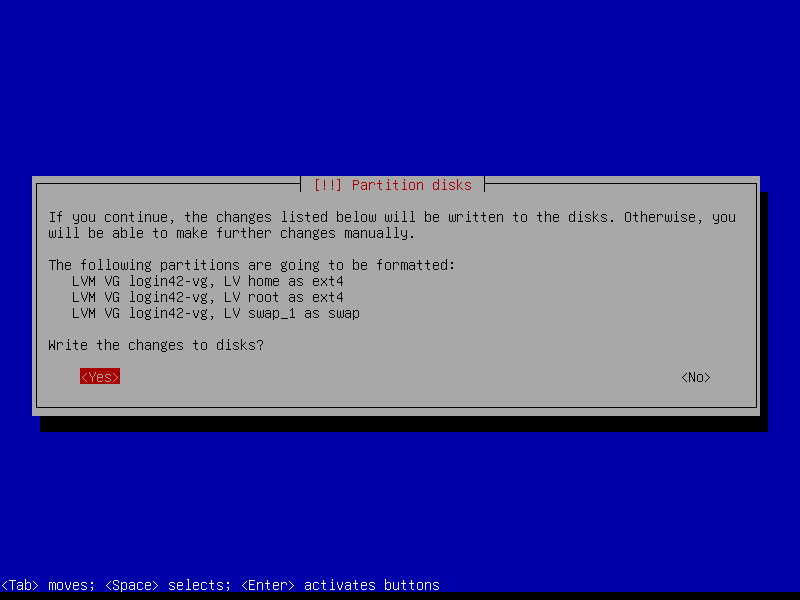
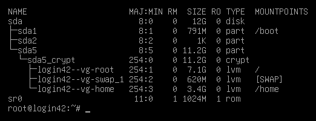

# Encrypted partitions and LVM

The subject asks for **at least 2 encrypted partitions using LVM**. The guided partitioning of the Debian installer is enough to meet this requirement.

## Steps in the installer

1. **Partitioning method**: <mark style="color:green;">Guided - use entire disk and set up encrypted LVM</mark>.

<figure><figcaption></figcaption></figure>

2. **Disk**: `sda`.

<figure><figcaption></figcaption></figure>

3. **Partitioning scheme**: <mark style="color:green;">Separate /home partition</mark>.

<figure><figcaption></figcaption></figure>

4. **Write the changes to disks and configure LVM**: <mark style="color:green;">Yes</mark>.

<figure><figcaption></figcaption></figure>

5. The installer overwrites the partition with random data. On a brand new virtual disk you can skip this with **Cancel** to save time.

<figure><figcaption></figcaption></figure>

6. **Encryption passphrase**: choose a strong passphrase and remember it. It is asked twice here, then at every boot.

<figure><figcaption></figcaption></figure>

7. **Amount of volume group to use**: keep the proposed maximum, or type `max`.

<figure><figcaption></figcaption></figure>


This screen shows the minimum size of the scheme: <mark style="color:green;">9.0 GB</mark>. A virtual disk smaller than that cannot use the `Separate /home partition` scheme.


8. Review the result, then **Finish partitioning and write changes to disk**.

<figure><figcaption></figcaption></figure>

9. **Write the changes to disks**: <mark style="color:green;">Yes</mark>.

<figure><figcaption></figcaption></figure>

## What you get

```
sda
├─sda1                  /boot        (not encrypted)
├─sda2                  (extended partition)
└─sda5                  (LUKS encrypted partition)
  └─sda5_crypt
    ├─login42--vg-root    /
    ├─login42--vg-swap_1  [SWAP]
    └─login42--vg-home    /home
```

Exact sizes depend on your disk. You have three logical volumes (`root`, `swap_1`, `home`) inside an encrypted volume group: the "at least 2 encrypted partitions using LVM" requirement is met.

## What you must be able to explain

- **`/boot` is not encrypted**: GRUB has to read the kernel before the passphrase is asked.
- **LUKS** encrypts the `sda5` partition. Once unlocked, it shows up as `sda5_crypt`.
- **LVM** splits that unlocked space into logical volumes.
  - **PV** (physical volume): the device used by LVM, here `sda5_crypt`.
  - **VG** (volume group): the pool of space made of one or more PVs.
  - **LV** (logical volume): a "partition" carved out of the VG.
- **Why LVM**: volumes can be grown, shrunk or added without repartitioning the disk.

## Check

Once the system is installed and booted:

```bash
lsblk
```

You must see `sda5_crypt` with type `crypt` and, below it, at least two lines with type `lvm`.

<figure><figcaption></figcaption></figure>
